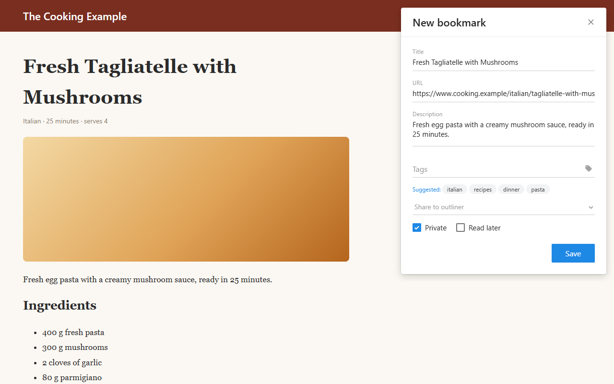
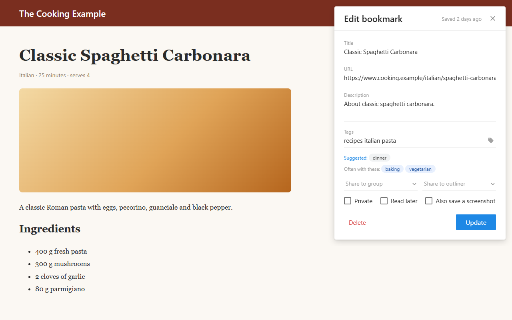
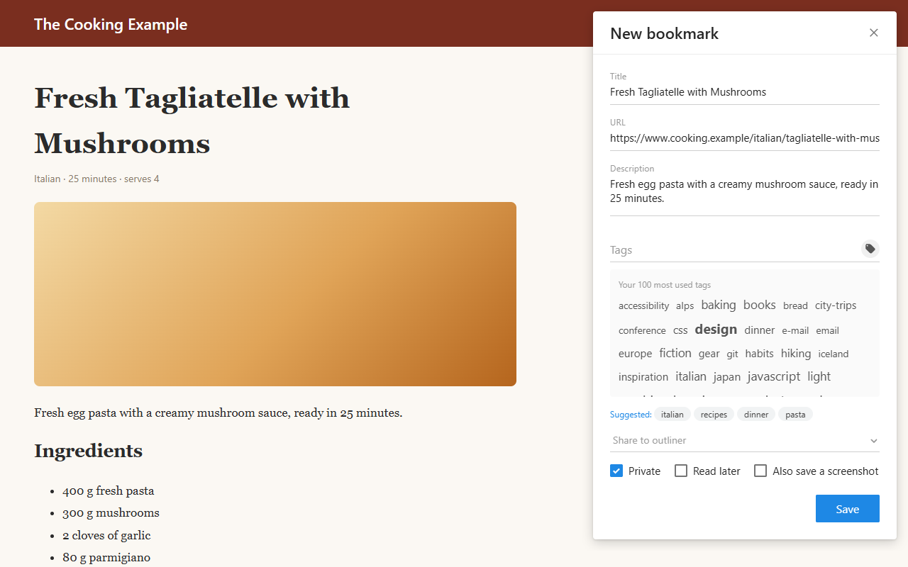
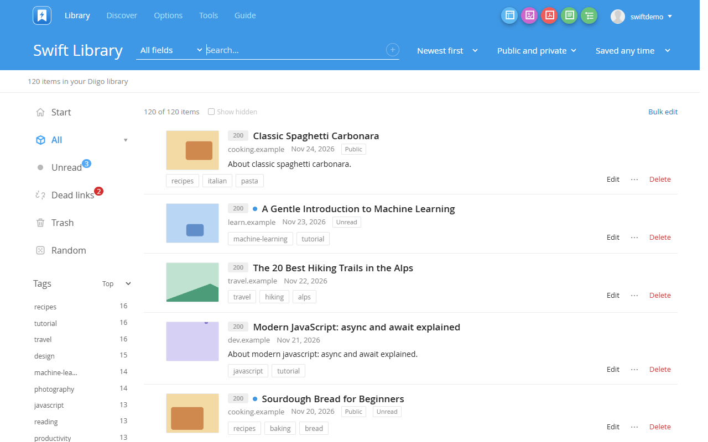
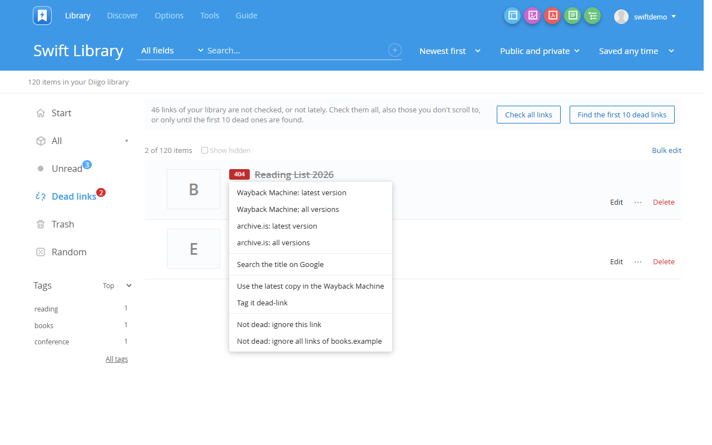
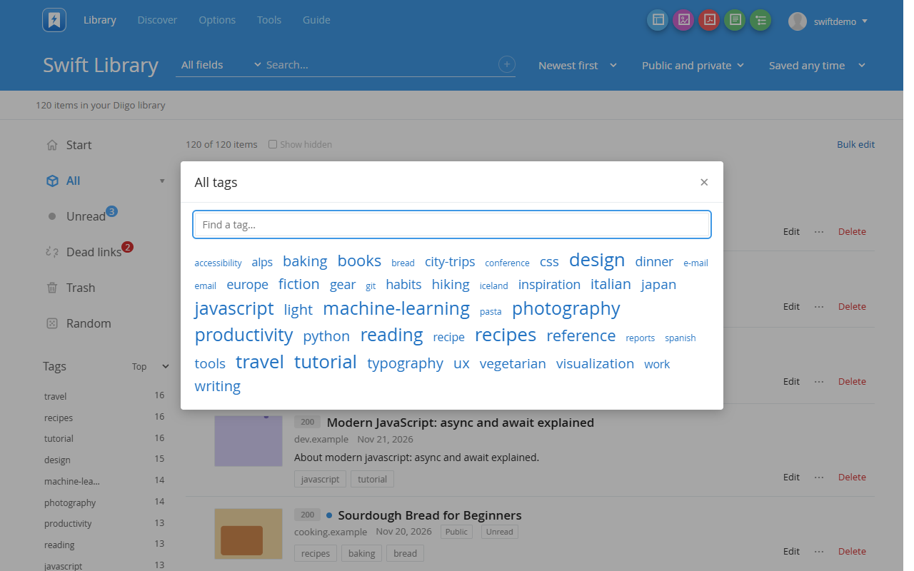
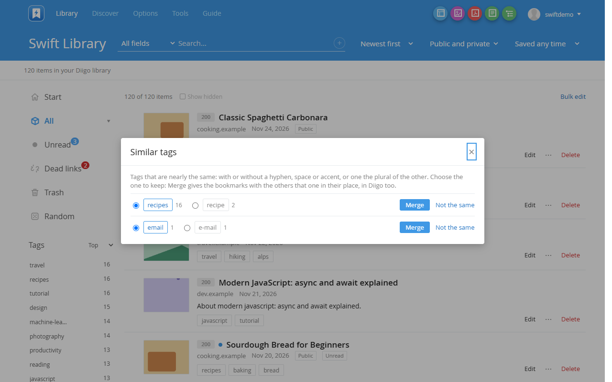
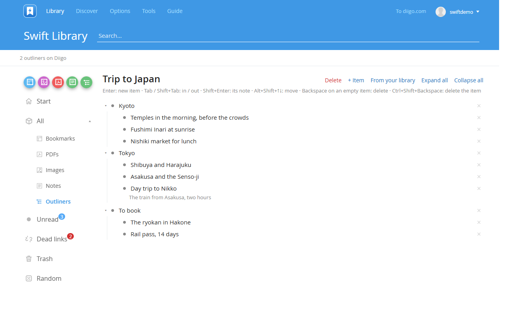
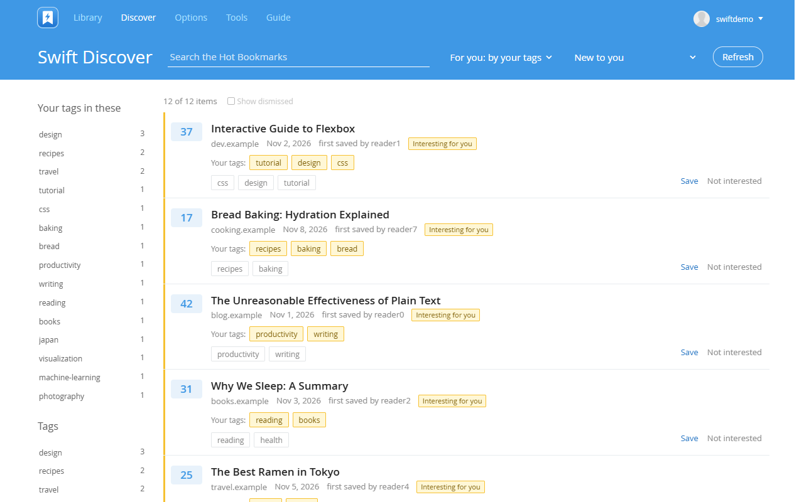

# Swift Bookmarks for Diigo

Save the page you're on, or a link, to your [Diigo](https://www.diigo.com) library in a second, with the right tags
already suggested. And find it all back in the Swift Library: your whole library on one fast page, also with thousands
of bookmarks.

[Install for Firefox][] (Firefox 140 or newer, also on Android), [install for Chrome][] (Chrome 121 or newer) or
[install for Edge][] (Edge 121 or newer).

[Install for Firefox]: https://addons.mozilla.org/firefox/addon/swift-bookmarks-for-diigo/
[Install for Chrome]: https://chromewebstore.google.com/search/Swift%20Bookmarks%20for%20Diigo
[Install for Edge]: https://microsoftedge.microsoft.com/addons/search/Swift%20Bookmarks%20for%20Diigo

**Unofficial**: this add-on is not made by Diigo and is not an official Diigo add-on. It is an alternative to Diigo's
own add-on, made for one thing: bookmarking, quickly and well. Highlighting and sticky notes are not in it; for those
there is Diigo's own add-on.

Find it useful? [Donate via PayPal](https://paypal.me/Smile4ever/10).

*The pictures below show a made-up library.*

## Save a page in a second

Click the toolbar button (or press Ctrl+Alt+D in Firefox, Alt+Shift+D in Chrome and Edge), or right-click a page or a
link → Save to Diigo. The form opens on the page, with the title, web address and description already filled in.

* **Tags that come to you**: your own tags that are in the title or the web address, the tags of your last bookmark on
  the same site, and, as you type, the tags you most often use together with them. For the rest, your tags complete as
  you type, and the tag icon shows your 100 most used tags.
* **Less to fill in**: a new bookmark gets the description the page gives of itself, and is saved without tracking
  parameters (utm_…, fbclid) at the web address the page calls its own.
* **Share and sort as you save**: Share to group, Share to outliner, Private and Read later.
* **A screenshot along, when you choose it**: tick Also save a screenshot and what the page shows is saved as a private
  image in your Diigo library, with the tags of the bookmark. It's off each time, as Diigo keeps only a limited number of
  images.
* **Nothing gets lost**: the form only closes once Diigo has saved the bookmark; otherwise it says why and keeps what
  you typed.
* **Save a link** from the right-click menu, with the title of the page it points to.

**You see what's saved**: the toolbar icon shows whether the page is already in your library. The form then opens with
what you saved before and when, and Delete. Saved the page before at nearly the same web address? The form says so,
with a way to edit that one instead.

## The Swift Library: your whole library at once

Your whole Diigo library as a page of the add-on. It keeps a copy in your browser, so searching, sorting and filtering
are instant. Open it from the menu of the toolbar button, or Go to Swift Library on diigo.com.

* **Search** all fields or one (title, web address, description, tags, the text of notes). `"between quotes"` is one
  phrase, `-word` leaves out what has it, and `tag*` in Tags finds every tag that starts so. `+` keeps a search as a
  filter above the list. Next to the search: the order, public or private, and when it was saved. Ctrl+F puts the
  cursor in the search box.
* **Filter** with a click on a tag or a site.
* **Bulk edit**: tick bookmarks (also with Shift+click) to add or remove tags, make them private or public, read or
  unread, share them to an outliner, or delete them, also thousands at once.
* **A picture at every bookmark**: the preview image of its page, as social sites show a link, or its icon.
* **The ⋯ of an item**: Mark as read or unread, Add to outliner, Share to group, Recreate (made again as a new item, the
  old one deleted), Delete screenshot, and Make public link, after a clear warning, for when you do want to share it.
* **Start** has blocks instead of one long list: Pinned (what has the tag `pinned`), Recently saved, To read, To do
  (tags that start with `todo`), Random, On this day, the trash, and Clean up. Customize Start moves blocks, leaves them
  out, and adds blocks of your own: what a search finds.
* **Add** bookmarks, images, PDFs, notes and outliners with the buttons at the top, as on diigo.com.
* **Notes, images and PDFs**: a click on the title of a note or an image shows it right there; a PDF opens in a new tab,
  in your browser's own PDF viewer. A note whose title ends in `.py`, `.js`, `.css`, `.html`, `.sql`… is code: shown
  and edited in colours.
* **Offline**: when diigo.com is down, View the library offline on the sign-in screen shows your library as the add-on
  last kept it.

### Hidden tags

Give a bookmark the tag `hidden`, or one of your own hidden tags, and it stays out of the Swift Library, the address bar,
Swift Discover and the suggestions of the form: handy for what you'd rather not see pop up when someone looks over
your shoulder. Search for the tag in full, or tick Show hidden, to see them. On diigo.com, in your own library, they are
left out too, with a Show hidden box at the bottom right.

**Hidden is not private**: others still see a public bookmark on diigo.com. Make it private too if no one else should
see it.

### Dead links, and the Wayback Machine

Before each title is the status of its page. A page that works is checked again after a week, one that is gone after 3
days, anything else after a day; Check all links checks the whole library at once.

| code | meaning |
|------|---------|
| 200 | the page works |
| red 404, 410 (title struck through) | the page is gone; also a page that leads to the home page of its site, or whose title says it isn't found |
| ERR | the site doesn't answer |
| PARKED | the domain is parked or for sale |
| → | the page moved for good to another web address |
| BOT | a bot protection (Cloudflare and the like) refused the check; the page may well work in a tab |
| grey 429 | the site asked to wait; it is asked again later |
| grey, struck through | you said Not dead, for this link or its whole site |

A click on the code: the Wayback Machine or archive.is, Search the title on Google, Use the latest copy in the Wayback
Machine, Use the new web address, Tag it dead-link, and Not dead.

### Tags: clean up and rename

* **All tags** as a cloud, the more you use one the larger, with a box to find one.
* **Rename a tag**: choose it in the side bar, then ✎ next to it. It changes on all your items at once, in Diigo too.
* **Similar tags** (e-mail and email, recipe and recipes), in Clean up on Start: choose the one to keep and Merge, or Not
  the same to leave them be.

Clean up on Start also has: bookmarks **without a title** (Fetch titles asks each page for its own), what has been
waiting **to be read** for over 3 months, **dead links**, **moved** pages, **duplicates** and **untagged** bookmarks.

### The trash

Delete asks nothing: the item goes to the trash at once, and Diigo deletes it 30 seconds later, so Put back in that time
simply cancels it. The trash keeps a copy for 30 days, also of what you delete on diigo.com, images and PDFs with their
file. Diigo itself has no trash.

### Outliners

Your outliners of Diigo are in the side bar too: a tree to write in with the keyboard, as on Diigo. Enter makes a new
item, Tab and Shift+Tab move it in and out, Shift+Enter writes its note, Alt+Shift+↑↓ moves it, and × deletes it. From
your library adds bookmarks as links. Changes are on Diigo a moment later.

## Swift Discover

The Hot Bookmarks of the Diigo community, without what is in your library already, in the order For you: those with
your own tags first, marked Interesting for you. Also Hot, Most saved and Newest first, a search box, filters by tag and
site, Save (with the bookmark form) and Not interested.

## And more

* **Your bookmarks in the address bar**: type `d`, a space and a few words, and the bookmarks with them are suggested;
  Enter on the words searches them in the Swift Library.
* **Random bookmark** in the menu of the toolbar button: one of your bookmarks, at random, in a new tab.
* **Your browser's bookmarks to Diigo**: choose folders in Swift Options, and their bookmarks go to Diigo, once or kept
  in sync, with the folder names as tags. In Firefox also Save to Diigo and Move to Diigo in the menu of a bookmark or
  folder. One way only: what you change or remove in the browser stays as it is in Diigo.
* **Your settings go along** to your other computers with the account of your browser.
* **Swift Guide** shows all this in the add-on itself; it opens once when you install it.
* **A log** of what went wrong, in Swift Options, with Save log for a bug report. Nothing is sent anywhere by itself.

On diigo.com the add-on changes little: Go to Swift Library at the end of the menu at the top, your hidden tags kept
hidden, and, if you choose so in Swift Options, My Library and Tools opening the Swift pages.

On Firefox for Android the button is in the menu of Firefox; there is no right-click menu, shortcut or address bar
search there.

## Shortcuts

| keys | what |
|------|------|
| Ctrl+Alt+D (Firefox), Alt+Shift+D (Chrome, Edge) | open or close the bookmark form; change it in the extension settings of the browser |
| Enter in Tags | save |
| Ctrl+S or Alt+S | save, in any field of the form |
| ↑ / ↓, then Enter or Tab | pick a suggested tag |
| Esc | close the suggested tags, then the form |

The shortcuts of the Swift Library and of outliners are in Swift Guide.

## Privacy

The add-on sends nothing to its maker. It talks to diigo.com for you, with your sign-in there, and the copy of your
library stays in your browser; it goes when you remove the add-on.

* While you're signed in, it asks Diigo whether each page you open is in your library, for the toolbar icon.
* To check dead links, and for the picture at each bookmark, it asks each page of your library from its own site.
  Rather not? In Swift Options, under Privacy, links are then only checked when you ask for it.
* A new public bookmark is saved private first and only then made public, and the add-on never makes a public link to
  an item by itself: Make public link is there for when you choose it.
* Your browser's bookmarks are read only when you allow it, and only the folders you choose go to Diigo.

All of it, and the choices about it, are in Swift Options under Privacy.

## For developers

How the add-on is put together, how to try and build it, and how a release goes: [docs/development.md](docs/development.md).
